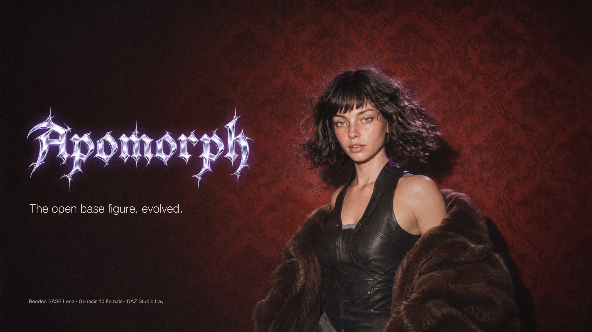
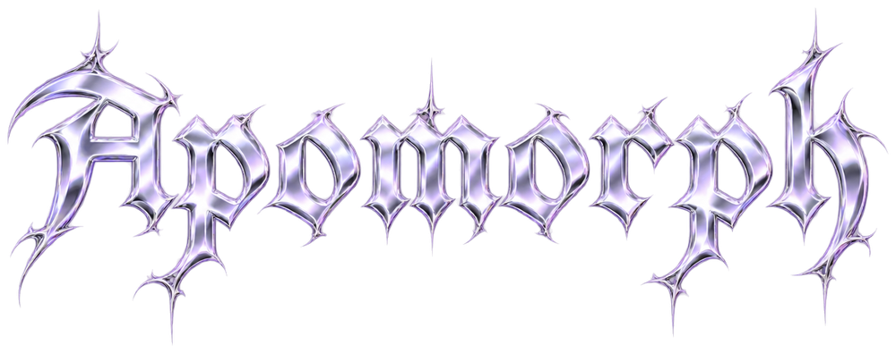

  

 
 

  

<b>THE OPEN BASE FIGURE, EVOLVED.</b>

 
 

  <code>A·PO·MORPH</code>&nbsp;&nbsp;<i>noun.</i> 
  a trait that appears for the first time in a lineage.

 
 

A BODY. 
FOR DAZ STUDIO. 
BUILT FROM OPEN PARTS. 
 
NOT A SEQUEL. 
A MUTATION.

 
 

<h1 align="center">COMING SOON</h1>

SEASON 01 &nbsp;·&nbsp; DATE WITHHELD &nbsp;·&nbsp; WATCH THIS REPOSITORY

 
 
 

Promo image: SASE Lena, rendered in DAZ Studio Iray. 
Apomorph is an independent project, not affiliated with or endorsed by Daz 3D.

